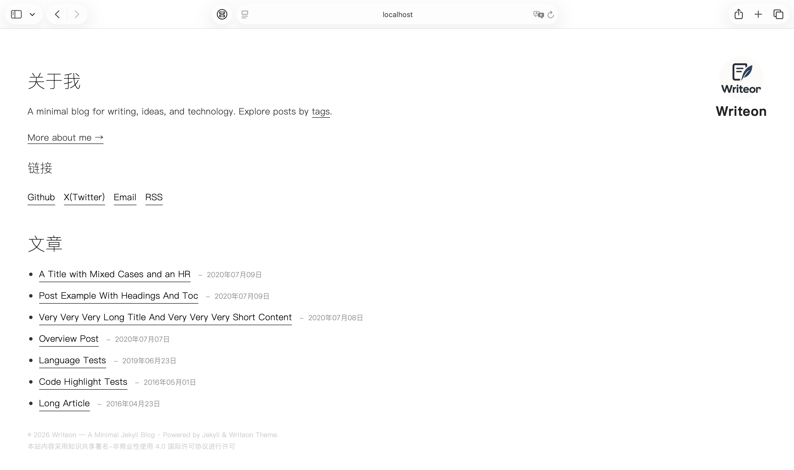
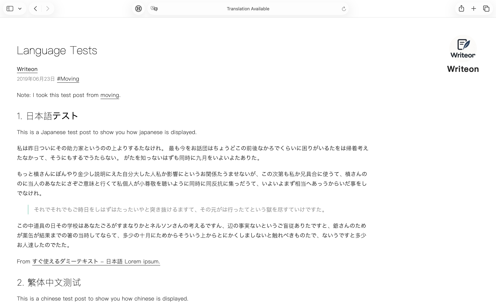
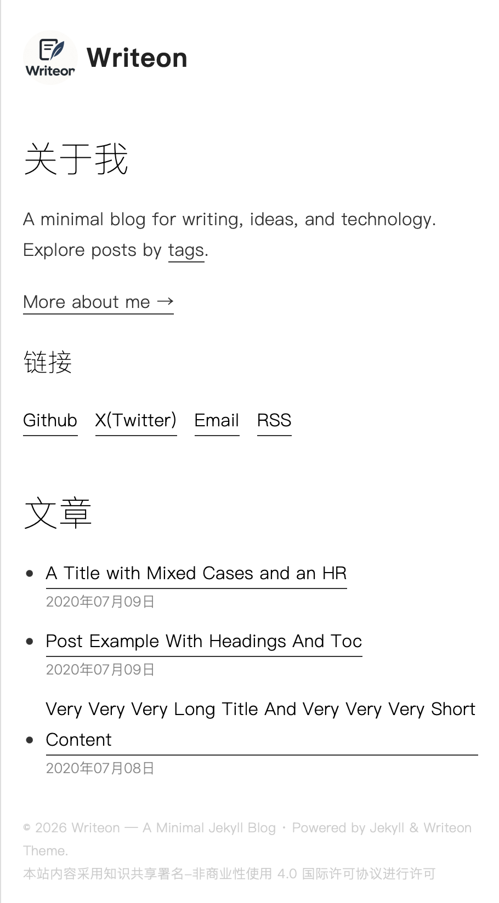
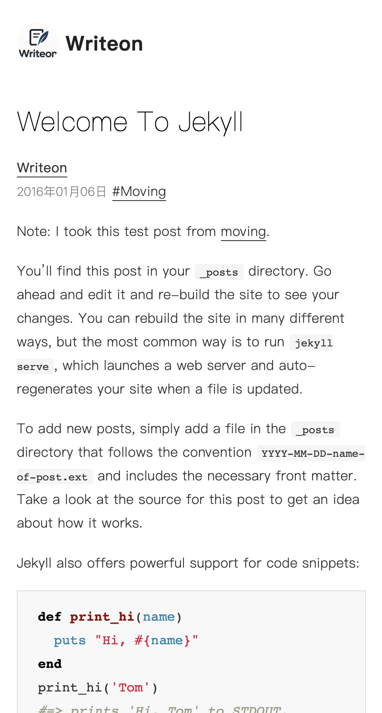

# jekyll-theme-writeon


Writeon is a minimal Jekyll theme for writers who believe content should come first. With a clean design, a simple layout, and a focus on readability, it puts your words at the center of the experience.

No unnecessary decorations. No endless customization. Just a quiet space to write, publish, and share your thoughts.

**Write first. Design less.**

## Features

- Minimal, content-first design
- Clean typography and readable layouts
- Responsive design for desktop and mobile
- Markdown-based writing with Jekyll
- Support for tags, footnotes, and RSS
- Sitemap generation with `jekyll-sitemap`

## Screenshots









## Installation

Add this line to your Jekyll site's `Gemfile`:

```ruby
gem "jekyll-theme-writeon"
```

And add this line to your Jekyll site's `_config.yml`:

```yaml
theme: jekyll-theme-writeon
```

And then execute:

    $ bundle

Or install it yourself as:

    $ gem install jekyll-theme-writeon

## Usage

Customize the theme through _config.yml. Configure your site title, description, theme_config, and other settings to suit your needs.

To add tags you must add a file with the tag name in _my_tags. In the file you add 2 variables: slug used to reference the tag and name which is displayed in the article header.

Writeon provides simple page layouts and reusable includes for building a clean, content-focused blog. Its styles and assets are designed to keep the interface minimal and the reading experience comfortable.

For detailed configuration options and examples, see the theme's source code and documentation.

## Contributing

Bug reports and pull requests are welcome on GitHub at https://github.com/grisse/jekyll-theme-writeon. This project is intended to be a safe, welcoming space for collaboration, and contributors are expected to adhere to the [Contributor Covenant](https://www.contributor-covenant.org/) code of conduct.

## Development

To set up your environment to develop this theme, run `bundle install`.

Your theme is setup just like a normal Jekyll site! To test your theme, run `bundle exec jekyll serve` and open your browser at `http://localhost:4000`. This starts a Jekyll server using your theme. Add pages, documents, data, etc. like normal to test your theme's contents. As you make modifications to your theme and to your content, your site will regenerate and you should see the changes in the browser after a refresh, just like normal.

When your theme is released, only the files in `_layouts`, `_includes`, `_sass` and `assets` tracked with Git will be bundled.
To add a custom directory to your theme-gem, please edit the regexp in `jekyll-theme-writeon.gemspec` accordingly.

## License

The theme is available as open source under the terms of the [MIT License](https://opensource.org/licenses/MIT).
